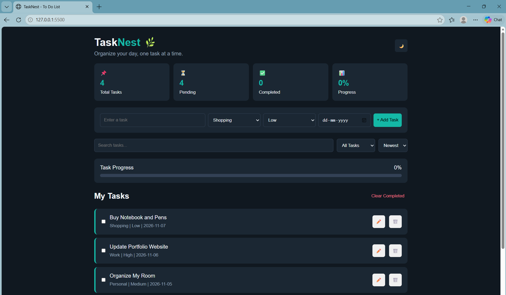

# Ex03 To-Do List using JavaScript
## Date:

## AIM
To create a To-do Application with all features using JavaScript.

## ALGORITHM
### STEP 1
Build the HTML structure (index.html).

### STEP 2
Style the App (style.css).

### STEP 3
Plan the features the To-Do App should have.

### STEP 4
Create a To-do application using Javascript.

### STEP 5
Add functionalities.

### STEP 6
Test the App.

### STEP 7
Open the HTML file in a browser to check layout and functionality.

### STEP 8
Fix styling issues and refine content placement.

### STEP 9
Deploy the website.

### STEP 10
Upload to GitHub Pages for free hosting.

## PROGRAM

### index.html


```html

<!DOCTYPE html>
<html lang="en">
<head>
    <meta charset="UTF-8">
    <meta name="viewport" content="width=device-width, initial-scale=1.0">
    <title>TaskNest - To Do List</title>
    <link rel="stylesheet" href="style.css">
</head>
<body>
<div class="app">
    <header>
        <div>
            <h1>Task<span>Nest</span> 🌿</h1>
            <p>Organize your day, one task at a time.</p>
        </div>
        <button id="theme">🌙</button>
    </header>

    <section class="stats">
        <div>📌 <b id="total">0</b><small>Total Tasks</small></div>
        <div>⏳ <b id="pending">0</b><small>Pending</small></div>
        <div>✅ <b id="done">0</b><small>Completed</small></div>
        <div>📊 <b id="percent">0%</b><small>Progress</small></div>
    </section>

    <section class="form">
        <input id="task" placeholder="Enter a task">
        <select id="category">
            <option>Study</option><option>Personal</option>
            <option>Work</option><option>Shopping</option>
        </select>
        <select id="priority">
            <option>High</option><option>Medium</option><option>Low</option>
        </select>
        <input type="date" id="date">
        <button onclick="addTask()">+ Add Task</button>
    </section>

    <section class="search">
        <input id="search" placeholder="Search tasks..." oninput="showTasks()">
        <select id="filter" onchange="showTasks()">
            <option value="all">All Tasks</option>
            <option value="pending">Pending</option>
            <option value="completed">Completed</option>
            <option value="high">High Priority</option>
        </select>
        <select id="sort" onchange="showTasks()">
            <option value="new">Newest</option>
            <option value="old">Oldest</option>
            <option value="priority">Priority</option>
        </select>
    </section>

    <section class="progress">
        <p>Task Progress <span id="progressText">0%</span></p>
        <div class="bar"><div id="bar"></div></div>
    </section>

    <h2>My Tasks <button onclick="clearDone()">Clear Completed</button></h2>
    <div id="list"></div>
    <p id="empty">No tasks available. Add a new task!</p>

    <footer>TaskNest © 2026 | HTML, CSS & JavaScript</footer>
</div>
<script src="script.js"></script>
</body>
</html>

```


### style.css 

```

* { box-sizing: border-box; margin: 0; padding: 0; }

:root {
    --bg: #101820; --card: #1b2733;
    --text: #f1f5f9; --main: #14b8a6;
}

body {
    font-family: Arial; background: var(--bg);
    color: var(--text); padding: 25px;
}

body.light {
    --bg: #eef5f4; --card: white; --text: #17252c;
}

.app { max-width: 950px; margin: auto; }

header, .search, .progress, h2 {
    display: flex; justify-content: space-between;
    align-items: center; gap: 10px; margin-bottom: 20px;
}

h1 span { color: var(--main); }
header p { color: #94a3b8; margin-top: 6px; }

button { cursor: pointer; padding: 10px; border: 0; border-radius: 6px; }
#theme { background: var(--card); }

.stats {
    display: grid; grid-template-columns: repeat(4, 1fr);
    gap: 12px; margin-bottom: 20px;
}

.stats div, .form, .progress, .task {
    background: var(--card); padding: 18px; border-radius: 10px;
}

.stats b, .stats small { display: block; margin-top: 7px; }
.stats b { color: var(--main); font-size: 23px; }

.form {
    display: grid; grid-template-columns: 2fr 1fr 1fr 1fr auto;
    gap: 8px; margin-bottom: 18px;
}

input, select {
    min-width: 0; padding: 11px; border-radius: 6px;
    border: 1px solid #334155; background: var(--card);
    color: var(--text);
}

.form button { background: var(--main); }

.search input { flex: 1; }

.progress { display: block; margin-bottom: 22px; }
.progress p { display: flex; justify-content: space-between; margin-bottom: 10px; }

.bar { height: 9px; background: #334155; border-radius: 10px; }
#bar { height: 100%; width: 0; background: var(--main); border-radius: 10px; }

h2 button { background: transparent; color: #fb7185; }

.task {
    display: flex; align-items: center; gap: 12px;
    margin-bottom: 10px; border-left: 4px solid var(--main);
}

.task-content { flex: 1; overflow-wrap: anywhere; }
.task small { display: block; margin-top: 8px; color: #94a3b8; }
.task.completed { opacity: .5; text-decoration: line-through; }

#empty { text-align: center; padding: 30px; color: #94a3b8; }
footer { text-align: center; margin: 30px; color: #94a3b8; }

@media(max-width: 700px) {
    .stats { grid-template-columns: 1fr 1fr; }
    .form { grid-template-columns: 1fr 1fr; }
    .search { flex-direction: column; }
}

@media(max-width: 450px) {
    .form { grid-template-columns: 1fr; }
}


```


### script.js

```

let tasks = JSON.parse(localStorage.getItem("nestTasks")) || [];

function save() {
    localStorage.setItem("nestTasks", JSON.stringify(tasks));
}

function addTask() {
    let title = document.getElementById("task").value.trim();

    if (!title) return alert("Enter a task!");

    tasks.push({
        id: Date.now(), title,
        category: category.value,
        priority: priority.value,
        date: date.value, completed: false
    });

    task.value = "";
    date.value = "";
    save();
    showTasks();
}

function showTasks() {
    list.innerHTML = "";

    let data = tasks.filter(t =>
        t.title.toLowerCase().includes(search.value.toLowerCase()) &&
        (filter.value === "all" ||
        (filter.value === "pending" && !t.completed) ||
        (filter.value === "completed" && t.completed) ||
        (filter.value === "high" && t.priority === "High"))
    );

    if (sort.value === "new") data.reverse();
    if (sort.value === "priority") {
        data.sort((a, b) =>
            ["Low", "Medium", "High"].indexOf(b.priority) -
            ["Low", "Medium", "High"].indexOf(a.priority));
    }

    data.forEach(t => {
        let div = document.createElement("div");
        div.className = "task" + (t.completed ? " completed" : "");

        let check = document.createElement("input");
        check.type = "checkbox";
        check.checked = t.completed;
        check.onchange = () => {
            t.completed = check.checked;
            save(); showTasks();
        };

        let content = document.createElement("div");
        content.className = "task-content";
        content.textContent = t.title;

        let info = document.createElement("small");
        info.textContent = `${t.category} | ${t.priority} | ${t.date || "No deadline"}`;
        content.appendChild(info);

        let edit = document.createElement("button");
        edit.textContent = "✏️";
        edit.onclick = () => {
            let name = prompt("Edit task:", t.title);
            if (name && name.trim()) {
                t.title = name.trim();
                save(); showTasks();
            }
        };

        let del = document.createElement("button");
        del.textContent = "🗑️";
        del.onclick = () => {
            tasks = tasks.filter(x => x.id !== t.id);
            save(); showTasks();
        };

        div.append(check, content, edit, del);
        list.appendChild(div);
    });

    empty.style.display = data.length ? "none" : "block";
    updateStats();
}

function updateStats() {
    let completed = tasks.filter(t => t.completed).length;
    let total = tasks.length;
    let p = total ? Math.round(completed / total * 100) : 0;

    document.getElementById("total").textContent = total;
    document.getElementById("pending").textContent = total - completed;
    document.getElementById("done").textContent = completed;
    document.getElementById("percent").textContent = p + "%";
    document.getElementById("progressText").textContent = p + "%";
    document.getElementById("bar").style.width = p + "%";
}

function clearDone() {
    tasks = tasks.filter(t => !t.completed);
    save(); showTasks();
}

theme.onclick = () => {
    document.body.classList.toggle("light");
};

showTasks();

```

## OUTPUT




## RESULT
The program for creating To-do list using JavaScript is executed successfully.